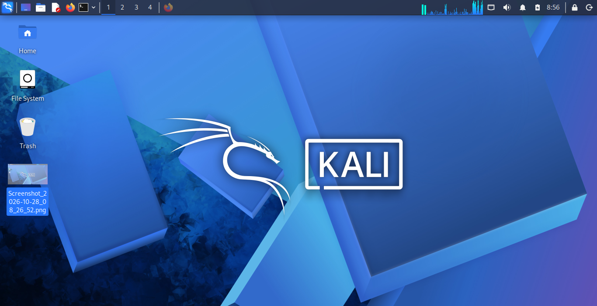
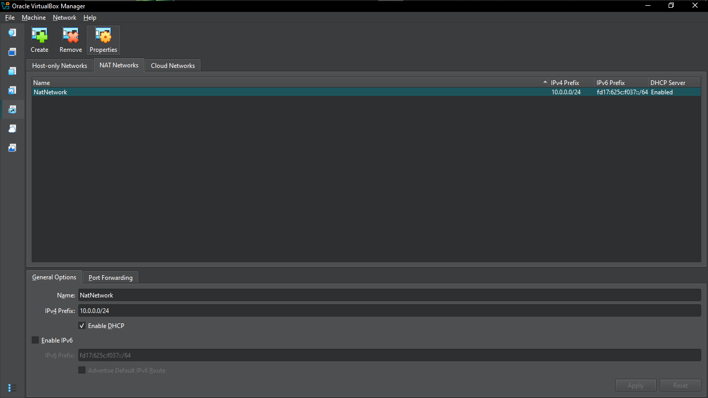
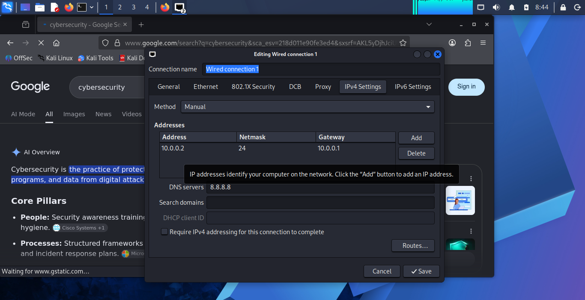
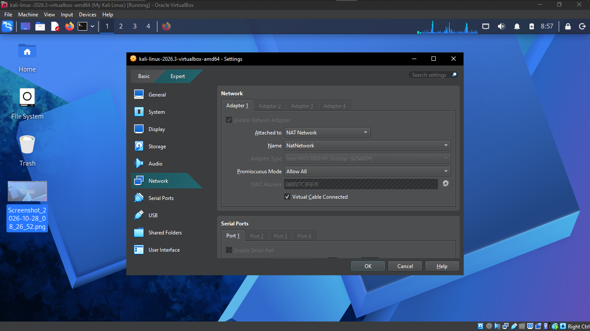

# 🛡️ Cybersecurity Lab Setup – NetworkWalks PM1 Week 1

## 📌 Introduction

This repository documents my first hands-on cybersecurity lab setup as part of my NetworkWalks PM1 training.

The goal of this project was to get familiar with setting up a virtual cybersecurity environment using Kali Linux and VirtualBox. I also explored the network configuration options available in VirtualBox, particularly NAT Network.

This was an opportunity to move beyond theoretical learning and gain practical experience with virtual machines and basic network configuration.

## 🎯 Project Objectives

- Install and prepare a Kali Linux virtual machine.
- Understand how VirtualBox manages virtual machines.
- Explore virtual network configuration.
- Configure and examine NAT Network settings.
- Document the setup process and important observations.

## 🧰 Tools and Technologies

| Tool | Purpose |
|---|---|
| Kali Linux | Linux distribution used for the cybersecurity lab |
| Oracle VirtualBox | Virtualization platform |
| NAT Network | Virtual networking configuration |
| GitHub | Project documentation and version control |

## 🖥️ Lab Environment

For this project, I used Oracle VirtualBox to create and manage my Kali Linux virtual machine.

The lab environment involved:

- A Kali Linux virtual machine.
- VirtualBox network settings.
- NAT Network configuration.

### Lab Screenshots

**1. VirtualBox Environment**

An overview of the virtual machine environment.

**2. Kali Linux**

My Kali Linux virtual machine.

**3. VirtualBox NAT Network Configuration**

Reviewing the NAT Network configuration within VirtualBox.

**4. Kali Linux Network Settings**

Examining the network settings assigned to the Kali Linux virtual machine.

**5. Kali Linux NAT Network**

The Kali Linux virtual machine with its NAT Network configuration.

## ⚙️ What I Worked On

During this exercise, I focused on the following activities:

1. Prepared the VirtualBox environment for the lab.
2. Set up the Kali Linux virtual machine.
3. Explored the available network configuration options.
4. Worked with NAT Network settings in VirtualBox.
5. Examined the network settings within Kali Linux.
6. Captured screenshots to document my progress.

## 📚 What I Learned

This project helped me develop a better understanding of:

- How virtualization works and why it is useful in cybersecurity.
- The role of Kali Linux in a cybersecurity learning environment.
- How virtual machines can be managed through VirtualBox.
- The importance of network configuration when building a lab environment.
- How NAT Network can be used to provide networking between virtual machines.

One important takeaway for me was understanding that setting up a cybersecurity lab is an important first step before carrying out practical security exercises.

## 🔐 Security Considerations

While working with virtual lab environments, it is important to:

- Use isolated lab environments when performing security experiments.
- Avoid testing tools against systems without authorization.
- Keep virtual machine software and operating systems updated.
- Practise responsible and ethical cybersecurity.

## 🚀 Future Improvements

As I continue learning, I plan to expand this lab by:

- Adding more virtual machines.
- Exploring different virtual networking modes.
- Practising basic network scanning.
- Learning more about network traffic analysis.
- Documenting additional cybersecurity exercises.

## 👨‍💻 Author

**Yomi Classy**

Cybersecurity Learner | Aspiring Security Professional

- GitHub: [@yomi-classy](https://github.com/yomi-classy)

---

⭐ This is one of my first practical cybersecurity projects. I will continue updating this repository as I build more knowledge and gain hands-on experience in cybersecurity.

**Learning by doing, one lab at a time.**
